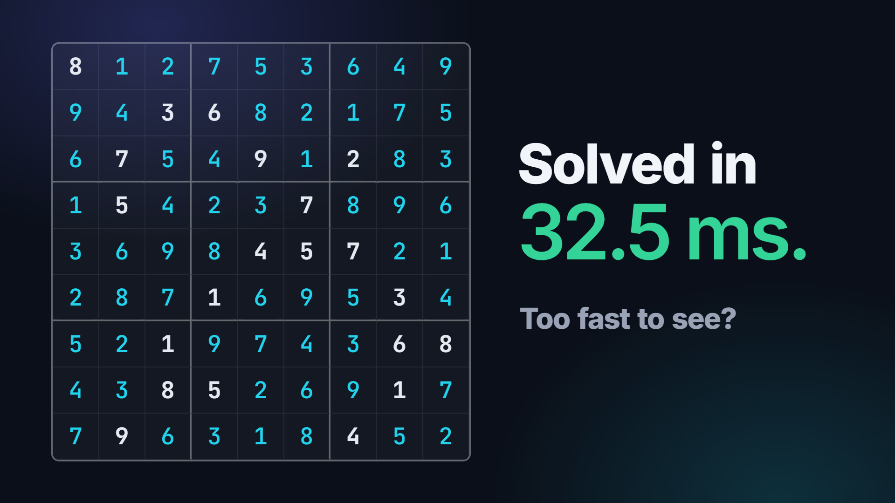
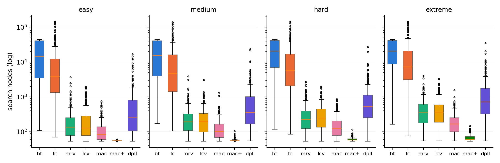
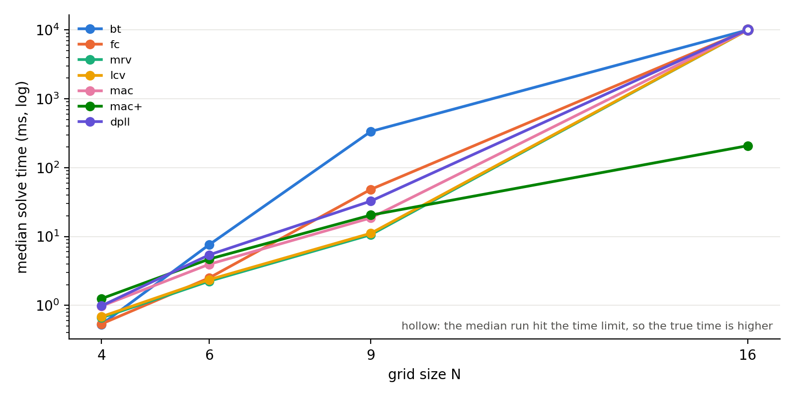

<div align="center">

# LogicPuzzleX

**One constraint engine. Many puzzles. Watch it think.**

An AI system that solves **Sudoku** and **Kakuro** as constraint satisfaction problems, using backtracking search, constraint propagation and propositional logic, and shows its reasoning live in the browser.

*CSE 440: Artificial Intelligence · North South University · Section 1 · Group 2*

### 🌐 [Live website: rayedriasat.github.io/logic-puzzle-x](https://rayedriasat.github.io/logic-puzzle-x/)

[](https://rayedriasat.github.io/logic-puzzle-x/)

**[▶ Watch the demo](https://rayedriasat.github.io/logic-puzzle-x/)** · **[🧩 Open the app](https://rayedriasat.github.io/logic-puzzle-x/app.html)**

</div>

> **Status: the Sudoku track is complete; Kakuro is next.** The roadmap is in [plan.md](plan.md).

## Highlights

| Feature | What it does | Status |
|---|---|---|
| Play | Solve it yourself while the engine checks after every move that the board can still be finished, with reasoned hints | Done |
| Watch it think | Animated replay of the search: candidates vanish as constraints propagate, cells flash on backtrack | Done |
| Algorithm race | Naive backtracking vs forward checking vs MRV vs MAC on the same puzzle, side by side | Done |
| One engine, many puzzles | Sudoku 4×4 to 16×16 and Kakuro, all modeled as factor graphs | Sudoku done; Kakuro planned (Phase 2) |
| Logic track | Sudoku → CNF, solved with our DPLL; uniqueness proved by entailment | Done |
| Explain mode | Every deduction in plain English ("r5c3 = 7: only place in box 4 for a 7") | Done |
| Generator | New puzzles with exactly one solution, graded Easy → Extreme | Done (Sudoku) |
| Benchmarks | Reproducible experiments behind every figure in our report | Done for Sudoku (E1–E5) |

## How it works

Each puzzle becomes a **factor graph**: variables `X_i` with domains, and factors `f_j(x) ∈ {0, 1}`. A complete assignment `x` solves the puzzle when

```text
weight(x) = f_1(x) · f_2(x) · … · f_m(x) = 1
```

A 9×9 Sudoku has 81 variables and 810 binary "≠" factors; Kakuro adds a sum factor for every run. The solver climbs an **algorithm ladder**:

| ID | Technique |
|---|---|
| `bt` | Naive backtracking (depth-first over partial assignments) |
| `fc` | + Forward checking |
| `mrv` | + Minimum remaining values (degree tie-break) |
| `lcv` | + Least constraining value |
| `mac` | Maintaining arc consistency (AC-3 after every assignment) |
| `mac+` | + Global all-different reasoning (hidden singles) |
| `dpll` | Propositional encoding solved with DPLL (unit propagation) |

## Results

Measured on a 4-vCPU Kaggle session with a 10 s limit per run; each time is the median of 3 runs. The solvers are pure Python, so the times compare techniques and say little about absolute speed. The raw data and figures are in [data/results/](data/results/), and the Benchmarks tab shows the same numbers.

**E1: what each technique buys** (1000 rated puzzles, 250 per difficulty bucket)

| Algorithm | Median nodes | Median ms | Timed out |
|---|---:|---:|---:|
| `bt` | 17,890 | 4,185 | 32.9% |
| `fc` | 5,446 | 406 | 2.3% |
| `mrv` | 210 | 27 | 0% |
| `lcv` | 219 | 30 | 0% |
| `mac` | 113 | 44 | 0% |
| `mac+` | 58 | 24 | 0% |
| `dpll` | 448 | 103 | 0% |

The `bt` and `fc` figures are lower bounds, because a run that hits the limit counts only the nodes it reached.



How the predictions in our plan held up:

| Prediction | Result |
|---|---|
| MRV gives the largest single jump | **Confirmed.** 23× fewer nodes than forward checking (paired median). No other step reaches 3×. |
| Naive backtracking times out on the hardest bucket while MAC solves everything in milliseconds | **Half right.** MAC solved all 1000 (median 44 ms, worst 634 ms). But `bt` timed out on 30% of easy puzzles and 36% of extreme ones, so its failures barely follow difficulty. |
| With `mac+`, most easy puzzles need no search | **Confirmed.** Zero backtracks on 100% of easy, 42% of medium, 33% of hard and 18% of extreme puzzles. |
| Effort correlates with difficulty, but imperfectly | **Confirmed.** Spearman ρ runs from 0.118 (`bt`) to 0.475 (`mac+`). The rating comes from an automated solver rather than from people, so this is not direct evidence about human difficulty. `bt` and `fc` are scored only on the puzzles they solved. |

Two results we did not predict: LCV adds nothing here (paired median 1.00×), and MAC roughly halves the nodes yet runs slower than MRV (44 ms against 27 ms). Hidden singles are what pay off: `mac+` is the fastest configuration, and its slowest puzzle took 67 ms.

**E3: one puzzle, three formulations** (200 rated puzzles)

| Formulation | Algorithm | Variables | Factors or clauses | Median nodes | Median ms |
|---|---|---:|---:|---:|---:|
| Binary ≠ | `mac` | 81 | 810 | 124 | 49 |
| Global AllDifferent | `mac` | 81 | 27 | 124 | 24 |
| Global + hidden singles | `mac+` | 81 | 27 | 58 | 25 |
| CNF | `dpll` | 729 | 11,745 | 441 | 108 |
| Extended CNF | `dpll` | 729 | 11,988 | 73 | 34 |

Global factors keep the same search and halve the time. The 243 redundant clauses of the extended CNF cut DPLL's nodes sixfold.

**E4: scaling up** (generated puzzles: 10 at 4×4, 12 at 6×6, 40 at 9×9, 8 at 16×16)

Every algorithm handles 9×9, and only `bt` times out there (12.5%). At 16×16 only `mac+` finishes, in a median 208 ms; the other six hit the limit on all 8 puzzles. Kakuro joins this comparison in Phase 2.



**E5: generator quality** (100 9×9 puzzles per requested grade)

| Requested | Hit rate | Median clues | Median seconds | Proved unique |
|---|---:|---:|---:|---:|
| Easy | 100% | 38 | 0.54 | 100% |
| Medium | 100% | 31 | 0.82 | 100% |
| Hard | 100% | 25 | 1.88 | 100% |
| Extreme | 67% | 24 | 16.65 | 100% |

An Extreme request that misses returns the closest grade instead; all 33 misses came back Hard. Uniqueness is proved by DPLL entailment up to 9×9. At 16×16 it rests on `mac+` finding no second solution, because our DPLL has no clause learning and cannot finish that proof. Clue counts follow the generator's target for each grade, so they are a setting and not a finding.

## Quick start

Requires Python 3.12. With [uv](https://docs.astral.sh/uv/):

```bash
uv venv --python 3.12
.venv\Scripts\activate          # macOS/Linux: source .venv/bin/activate
uv pip install -r requirements.txt
python main.py
```

With plain pip:

```bash
python -m venv .venv
.venv\Scripts\activate          # macOS/Linux: source .venv/bin/activate
pip install -r requirements.txt
python main.py
```

The overview page opens at <http://127.0.0.1:8000> and the app is at `/app.html`; API docs are at `/docs`.

## Usage

```text
python main.py                                   # launch the web app
python main.py solve "<puzzle>" --algo mac       # solve from the command line (add --explain for the reasoning)
python main.py bench --exp e1                    # run an experiment, write data/results/ (see data/README.md)
python main.py generate --difficulty hard        # create a puzzle with a unique solution
python main.py site                              # build the static website for GitHub Pages into site/
python -m pytest -q                              # run the tests
```

## Deploy

The website (an overview page with the demo video, plus the app at `app.html`) is published to **GitHub Pages** for free. Pages only serves static files, so the static build runs the solver's Python code in the visitor's browser with [Pyodide](https://pyodide.org) (WebAssembly). No server is needed. The first visit downloads about 12 MB of Pyodide, and solving runs roughly 3× slower than under `python main.py`.

[.github/workflows/pages.yml](.github/workflows/pages.yml) builds and publishes the site on every push to `main`. One-time setup: in the repo, open **Settings → Pages** and set **Build and deployment → Source** to **GitHub Actions**. The site is live at <https://rayedriasat.github.io/logic-puzzle-x/>.

To build and preview it locally:

```bash
python main.py site                 # writes site/
python -m http.server -d site       # open http://localhost:8000
```

How it fits together: [support/api.py](support/api.py) holds the API logic that both front ends use. The FastAPI server ([support/server.py](support/server.py)) wraps it for local use. [support/site.py](support/site.py) zips it with the solver modules and `data/sudoku/` into `py.zip`, precomputes `benchmarks.json`, and sets `config.js` so that `api.js` sends requests to Web Workers ([support/web/pyworker.js](support/web/pyworker.js)) rather than to `/api`.

## Repository structure

Organized as the course manual requires:

```text
├── main.py            # entry point: serve | solve | bench | generate | site
├── README.md          # this file
├── requirements.txt   # Python libraries
├── data/              # datasets (see data/README.md)
├── support/           # all other code: CSP engine, puzzles, SAT, web UI, tests
└── others/            # reports (PDF), presentations (PPTX), demo video
```

## Code tour

This table is the route for our 4-minute code walkthrough.

| Step | File | What to look at |
|---|---|---|
| 1 | [main.py](main.py) | CLI and how the app starts |
| 2 | [support/csp.py](support/csp.py) | Factor graph model, `weight(x)`, `delta` |
| 3 | [support/solver.py](support/solver.py) | One backtracking search; `ALGORITHMS` is the whole ladder |
| 4 | [support/propagation.py](support/propagation.py) | Forward checking, AC-3, hidden singles |
| 5 | [support/trace.py](support/trace.py) | The event log the UI replays |
| 6 | [support/sudoku.py](support/sudoku.py) | Puzzle → factors |
| 7 | [support/sat.py](support/sat.py) | CNF encoding, DPLL, uniqueness by entailment |
| 8 | [support/explain.py](support/explain.py) · [support/generator.py](support/generator.py) | Deductions in English; unique graded puzzles |
| 9 | [support/benchmark.py](support/benchmark.py) · [support/figures.py](support/figures.py) | Experiments E1–E5 |
| 10 | [support/api.py](support/api.py) · [support/server.py](support/server.py) · [support/web/](support/web/) | API and UI (`replay.js` drives every animation); `index.html` is the overview page, `app.html` the app |
| 11 | [support/tests/](support/tests/) | pytest suite, run by CI on every push |

## Team

| Name | Student ID | Role |
|---|---|---|
| Md Shihabul Alam Shihab | 2233115642 | CSP engine and search |
| Rayed Riasat Rabbi  | 2311649042 | Puzzle modeling, propagation, generator |
| Rifat Imtiaze Ruddro | 2311474642 | Logic track, explanations, experiments |
| Sayma Akhter Snigdha | 1620838042 | Web app, demo video, integration |

## References

Full list in our final report. Key sources: Russell & Norvig, *AIMA* (Ch. 6–7); Mackworth (1977) on AC-3; Haralick & Elliott (1980) on forward checking; Davis, Logemann & Loveland (1962) on DPLL; Simonis (2005) and Lynce & Ouaknine (2006) on Sudoku as CSP and SAT; the CSE 440 course notes.

## Acknowledgements

Course: CSE 440, North South University. AI tools: Claude (Anthropic) helped draft the project plan and the repository scaffold; all solver code and experiments are written and verified by the team.
