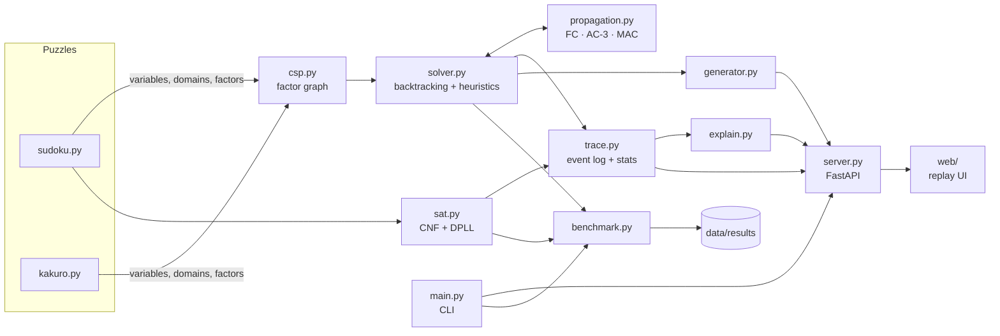

# LogicPuzzleX: Project Plan

> **CSE 440: Artificial Intelligence** · Section 1 · Group 2
> **Topic:** Logic Puzzle Solver. An AI system that solves logic puzzles such as Sudoku and Kakuro with constraint satisfaction techniques (backtracking, constraint propagation).

---

## 0. The idea in one paragraph

**LogicPuzzleX is a single constraint-satisfaction engine that solves Sudoku (4×4 up to 16×16) and Kakuro.** You can watch it reason move by move, race search algorithms against each other on the same puzzle, read its deductions in plain English, generate new puzzles that have exactly one solution, and check uniqueness with propositional logic. Every puzzle is modeled as a **factor graph** (variables, domains, factors) using the notation from class. That gives us one generic solver, and adding a new puzzle type only means writing its list of factors.

**Tagline:** *One constraint engine. Many puzzles. Watch it think.*

### Why it stands out (and why it stays small)

| Hook | What the audience sees | Why it is low effort |
|---|---|---|
| **Watch it think** | Pencil-mark candidates vanish as constraints propagate; cells flash red on backtrack; a ripple plays when the puzzle is solved | The solver records an event log and the browser replays it. One replay engine drives every animation. |
| **Algorithm race** | Four boards solve the same puzzle at the same events-per-second. MAC finishes while naive backtracking is still going. | Reuses the replay engine four times |
| **"World's hardest Sudoku" in milliseconds** | Arto Inkala's 2012 puzzle solved instantly by MAC | It's a preset puzzle |
| **Proof of uniqueness** | "Unique ✓: KB ∪ {¬s} is unsatisfiable, so KB ⊨ s" | One blocking clause plus the DPLL solver (Course Vol. 4, p. 31) |
| **Explain mode** | "r5c3 = 7: it is the only cell in box 4 that can still hold a 7" | Prune events already carry the factor that caused them |
| **Puzzle generator** | New puzzles with exactly one solution, graded Easy → Extreme | Solver + solution counting |
| **One engine, many puzzles** | Sudoku 4×4 / 9×9 / 16×16 and Kakuro (Killer Sudoku as a stretch goal) | A puzzle is just a list of factors |
| **Built on the class formalism** | Hover a cell to see its *Markov blanket* (20 peers); factor counts; the class's CSP pseudocode | A naming and visual layer over the same engine |

---

## 1. Course-manual compliance checklist

This section is the contract. Everything in it is required by the Course Manual. Tick items off as they are done.

### 1.1 Repository (single **public** GitHub repo)
- [ ] Link submitted on **Google Classroom before the start of Class 6**.
- [ ] `main.py` at the root runs the project.
- [ ] `README.md` explains the project. It is the first thing shown in the code presentation, so it must be well written.
- [ ] `requirements.txt` lists all libraries.
- [ ] `data/` holds the datasets. Large files stay out; we commit a sample plus a download script.
- [ ] `support/` holds **all other code** (Python modules, web UI, tests).
- [ ] `others/` holds: **a)** final presentation PPTX, **b)** final report PDF, **c)** update presentation PPTX, **d)** update report PDF, **e)** one-minute demo video.
- [ ] Commit history shows **continuous work by every member across the semester**. The manual names "insufficient GitHub activity" and "lacking in working as a team" as penalties.

### 1.2 Project update (Class 12): 3% of the course
| Deliverable | Where | Deadline |
|---|---|---|
| Update presentation (PPTX) | GitHub `others/` | Before the start of Class 12 |
| 2-page update report (PDF) | GitHub `others/` | Before the start of Class 12 |
| Printed update report: **both-sided, no top page, no spiral binding** | In class | **At the very start** of Class 12 |
| Code | GitHub | Before the start of Class 12 |

- Slot: 5 min = **1 min preparation + 4 min presentation (PPTX + GitHub)**. Time is split equally and **every member speaks**.
- Our slot: Group g presents from minute 5 + 5g to 10 + 5g. For Group ‹N› that is **‹start›–‹end›**. If the previous group overruns, **we start anyway, on time**, or we lose our own minutes.
- We present only from files already on GitHub before the deadline. **No laptops.**

### 1.3 Final submission (Class 23) and presentation (Class 23 or 24): 12% of the course
| Deliverable | Where | Deadline (all groups) |
|---|---|---|
| Final presentation (PPTX) | GitHub `others/` | Before the start of Class 23 |
| 8-page final report (PDF) | GitHub `others/` | Before the start of Class 23 |
| Printed final report: **both-sided, no top page, no spiral binding** | In class | **At the very start** of Class 23 |
| Code | GitHub | Before the start of Class 23 |
| One-minute demo video (screen capture of the app from the user's point of view) | GitHub `others/` | Before the start of Class 23 |

- Groups 1–5 present in Class 23 and groups 6–10 in Class 24. **Everyone must attend both classes.**
- Slot: 15 min = **2 min prep + 6 min PPTX + 1 min video + 4 min code from GitHub + 2 min Q&A**. PPTX and code time is split equally and everyone speaks.
- Group g starts at minute 15·g (groups 1–5, Class 23) or 15·(g − 5) (groups 6–10, Class 24). We start on time no matter what.
- The code part must show: **1)** the repo home page with the README, **2)** a quick scroll through the commit history, **3)** every part of the code, **4)** every part of the repo, all within 4 minutes. That is why the codebase must stay small and flat (see §3.11 and §8.6).
- **Bonus:** asking questions during other groups' final presentations. Each of us should ask at least one.

### 1.4 Report rules (update and final)
- Professional article format: **IEEE double-column** (`IEEEtran`, conference mode). Figures, equations and write-up must look professional.
- **No title page.** Above the top margin of page 1, a header with: **course code & section, group number, names and IDs of all members** (tested snippet in Appendix A).
- Length: **2 pages** (update), **8 pages** (final).
- **Cite every reference**, including videos and **AI tools**. Paraphrase; no plagiarism.

### 1.5 Presentation rules (update and final)
- **Footer on every slide** with **group number + names of all members**. This is mandatory: set it in the Slide Master.
- **Start by introducing every member with their full name.**
- Graded on: speaking to the point, clear explanation, slide quality, generating curiosity, content specific to our work.
- Penalized for: unnecessary slides, wasted time, finishing late *or early*, too much text, generic "fits-for-all" slides.
- PPTX focuses on the big picture; the code walkthrough uses technical language.

---

## 2. Project definition

### 2.1 Problem statement
Logic puzzles such as Sudoku and Kakuro are constraint satisfaction problems (CSPs): assign values to variables so that every constraint holds. Generalized Sudoku is NP-complete, yet good CSP techniques solve typical 9×9 instances in milliseconds. We build one engine that models each puzzle as a factor graph and solves it with a ladder of increasingly capable algorithms. We then **measure** how much each technique contributes, **explain** the solver's reasoning, and **compare** two AI paradigms on the same task: CSP search and propositional logic (SAT).

### 2.2 Research questions (these drive the report's experiments)
- **RQ1 (ablation):** How much does each technique (forward checking, MRV/degree, LCV, AC-3/MAC, global AllDifferent reasoning) cut search effort and runtime?
- **RQ2 (difficulty):** Does solver effort predict human-rated difficulty? What fraction of puzzles need no search at all, only propagation?
- **RQ3 (formulation):** How do a binary-≠ CSP, a global-constraint CSP and a propositional CNF encoding of the same puzzle compare in size and speed?
- **RQ4 (generality and scale):** How does the engine scale from 4×4 to 16×16 Sudoku, and to Kakuro, without puzzle-specific search code?

### 2.3 Course concept map (put this table in both reports and on a slide)
| Feature | Course concept | Volume |
|---|---|---|
| Puzzle → variables, domains, factors; `weight(x) = ∏ f_j(x)` | Factor graphs, CSP, scope, arity | Vol. 3 |
| Consistency check via dependent factors `D(x, X_i)` | CSP algorithm pseudocode | Vol. 3 |
| Givens fixed by conditioning (variable and its factors removed) | Conditioning | Vol. 3 |
| Hover a cell → its 20 peers | Markov blanket | Vol. 3 |
| Depth-first exploration of partial assignments | Backtracking search, DFS | Vol. 1 |
| Forward checking, AC-3 / MAC | Domain updates in the CSP pseudocode, constraint propagation | Vol. 3 |
| Sudoku → CNF; DPLL with unit propagation | Propositional logic, CNF, satisfiability, resolution / modus ponens | Vol. 4 |
| Uniqueness proof: KB ∪ {¬s} unsatisfiable ⇔ KB ⊨ s | Entailment, proof by contradiction | Vol. 4 |
| Explain mode (each deduction cites its rule) | Inference rules, derivation (KB ⊢ f), soundness | Vol. 4 |
| *(Stretch)* digit recognition for photo import | Linear classification, k-NN, ML pipeline | Vol. 1 |

### 2.4 Scope tiers

**P0: MVP, done before the update (Class 12)**
- Factor-graph CSP model and backtracking solver: naive BT, forward checking (FC), MRV.
- Sudoku encoding for any box size (4×4, 6×6, 9×9, 16×16).
- CLI: `solve`, `bench` (first version).
- Web UI v1: enter or paste a puzzle, pick an algorithm, solve, animated replay with play/pause/step/speed, live stats.
- Preliminary benchmark: 3 algorithms × ~100 puzzles, one chart.

**P1: Final core, done before the feature freeze (Class 21)**
- AC-3 and MAC, degree tie-break, LCV, global AllDifferent hidden-single rule (`mac+`).
- Kakuro encoding (sum + all-different runs) and a Kakuro board in the UI.
- SAT track: CNF encoding + DPLL + uniqueness by entailment.
- **Race mode**, **Explain mode**, **Generator** (unique solution, graded), **Benchmarks** tab.
- Full experiments E1–E5 (§4), tests, CI badge, README with GIF and code tour.

**P2: Stretch, only once P1 is frozen and the report is drafted**
- Killer Sudoku (reuses the Kakuro sum factor; about 30 lines).
- Australia map-coloring demo drawn as the class's factor graph.
- Search-tree view for 4×4 puzzles (like the DFS figures in class).
- "Snap & Solve": photo import with OpenCV grid detection and a small digit classifier.
- Public live demo (Render or Hugging Face Spaces).

---

## 3. Technical design

### 3.1 Tech stack

| Layer | Choice | Why |
|---|---|---|
| Language | **Python 3.12** | The course expects `main.py` and `requirements.txt`; readable code for a 4-minute walkthrough |
| Environment | **uv** (`uv venv`, `uv pip install -r requirements.txt`) | Fast and reproducible. `requirements.txt` stays the single source of truth, as the manual requires. |
| Algorithms | **Plain Python, written by us** (no OR-Tools, python-constraint or pycosat) | The algorithms are what gets graded. Using a library solver would hide our work. |
| Backend | **FastAPI + Uvicorn** | Tiny, typed, and the auto-generated `/docs` page gives a free API demo |
| Frontend | **Vanilla HTML/CSS/JS (ES modules), no build step**, served by FastAPI from `support/web/` | No Node, no `node_modules`, nothing outside `requirements.txt`. The whole UI is 3 files the audience can see in 30 seconds. |
| Charts (UI) | Chart.js from a CDN | One `<script>` tag for the Benchmarks tab |
| Figures (report) | **matplotlib + numpy** | Publication-quality PDF/PNG figures from `python main.py bench` |
| Tests / CI | **pytest + GitHub Actions** | Green badge on the README; shows engineering discipline |
| Report | **LaTeX `IEEEtran` on Overleaf** (shared project) | IEEE double-column as required; all members edit at once |
| Slides | **PowerPoint (.pptx)** | Required format. Footer set via Slide Master. |
| Video | **OBS Studio** (or Win + Alt + R), H.264 MP4, 1080p, ≤ 60 s, < 50 MB | GitHub blocks files over 100 MB and warns over 50 MB |

**Alternatives considered and rejected:**
- *Streamlit:* its rerun-on-every-interaction model makes step-by-step animation janky, and it looks generic.
- *Pygame:* no web, no charts, and hard to make look polished.
- *React/Vite:* adds a Node toolchain outside `requirements.txt` and many more files to walk through in 4 minutes.

**Key architectural choice: trace replay.** Python solves at full speed and records a compact event log (assign, prune, backtrack, solve). The browser replays that log at any speed with scrubbing, so animations run at 60 fps without websockets, and Race mode is simply four replays side by side.

### 3.2 Architecture



### 3.3 The CSP model (class notation, used verbatim in the report)
- Variables `X = {X_1, …, X_n}`, domains `Domain_i`.
- Factors `f_j(x) ∈ {0, 1}` with a **scope** (the variables they depend on) and an **arity** (|scope|).
- `weight(x) = ∏_{j=1}^{m} f_j(x)`. An assignment is **consistent** iff `weight(x) = 1`.
- Dependent factors `D(x, X_i)` = the factors whose scope includes `X_i` and only assigned variables. The consistency check for `X_i = v` is `δ = ∏_{f ∈ D(x, X_i)} f(x ∪ {X_i : v})`, exactly as in the class pseudocode.
- Each factor object implements `is_satisfied(assignment)` (used by `weight` and `δ`) and `revise(domains)` (used by propagation). Binary ≠ factors and n-ary sum factors share that one interface.

### 3.4 Algorithm ladder (`--algo` names)
| ID | Name | Variable order | Value order | Inference after each assignment |
|---|---|---|---|---|
| `bt` | Naive backtracking (class pseudocode without domain updates) | static, row-major | ascending | none; `δ` check only |
| `fc` | Forward checking (class pseudocode with "update domains") | static | ascending | prune neighbors of the assigned variable |
| `mrv` | FC + Minimum Remaining Values | MRV, degree tie-break | ascending | FC |
| `lcv` | FC + MRV + Least Constraining Value | MRV + degree | LCV | FC |
| `mac` | Maintaining Arc Consistency | MRV + degree | LCV | AC-3 over all affected factors |
| `mac+` | MAC + global AllDifferent reasoning | MRV + degree | LCV | AC-3 + hidden-single rule per unit |
| `dpll` | Propositional SAT (Vol. 4) | branch on a literal from the shortest clause | true first | unit propagation (+ pure literals) |

All configurations count **nodes** (assignments tried), **backtracks**, **constraint checks**, **prunes** and **wall time**, and accept a timeout.

### 3.5 Puzzle encodings
**Sudoku (box `br × bc`, size `N = br·bc`):**
- Variables `X_{r,c}` with domain `{1..N}`. Givens are applied by **conditioning**: the variable is fixed and its factors are reduced.
- Factors: `[X_{r,c} ≠ X_{r',c'}]` for every pair of *peers* (same row, column or box). For 9×9: 81 variables and **810 binary factors**. Every cell has **20 peers**, which is its **Markov blanket**.
- Global variant (`mac+`): 27 AllDifferent factors (one per row, column and box) with a hidden-single rule.

**Kakuro (text format in `data/kakuro/`):**
- Tokens: `#` black cell, `.` white cell, `D\R` clue cell with down-sum `D` and right-sum `R` (`-` when absent).
- Variables: white cells with domain `{1..9}`. For each run `R` with clue `s`: a sum factor `[Σ_{i∈R} X_i = s]` and `[X_i ≠ X_j]` for every pair in `R`.
- Propagation for sum factors: precompute every digit combination for each (run length, sum) pair, then restrict each cell to the digits that still appear in a combination compatible with the current domains (a light form of generalized arc consistency).

**Propositional (CNF) encoding of Sudoku:**
- Symbols `p_{r,c,v}` ("cell (r,c) holds v"): 729 symbols for 9×9.
- Clauses: each cell holds at least one value; at most one value per cell; each value appears at most once per row, column and box (plus the redundant "at least once" clauses in the extended encoding). Givens become unit clauses. That is roughly 9k–12k clauses depending on the encoding.
- **Uniqueness:** with solution `s`, add the blocking clause `¬s = ∨ ¬p_{r,c,s(r,c)}` over the non-given cells. If `KB ∪ {¬s}` is unsatisfiable, then `KB ⊨ s` and the solution is unique (Course Vol. 4, p. 31).

### 3.6 Trace format (solver → UI)
```json
{
  "puzzle": {"type": "sudoku", "size": 9, "grid": "8........"},
  "algorithm": "mac",
  "solution": "812753649...",
  "stats": {"nodes": 128, "backtracks": 41, "checks": 9031, "prunes": 2210, "ms": 37.5},
  "events": [["A", 40, 7], ["P", 41, 7, "row"], ["B", 40], ["S"]],
  "truncated": false
}
```
`A` = assign (variable, value), `P` = prune (variable, value, reason), `B` = backtrack (variable), `S` = solved. Events are capped at about 100k: when the cap is reached the solver keeps solving, stops recording, and sets `truncated: true`.

### 3.7 HTTP API (`support/server.py`)
| Method | Path | Purpose |
|---|---|---|
| GET | `/api/health` | Liveness check *(already implemented)* |
| GET | `/api/puzzles?type=sudoku&difficulty=hard` | Sample puzzles from `data/` |
| POST | `/api/solve` | `{type, puzzle, algorithm, trace, explain}` → solution, stats, trace |
| POST | `/api/race` | `{type, puzzle, algorithms[]}` → one result per algorithm |
| POST | `/api/generate` | `{type, size, difficulty}` → puzzle, solution, grade |
| GET | `/api/benchmarks` | Latest results from `data/results/` for the Benchmarks tab |
| GET | `/docs` | Auto-generated API docs (FastAPI) |

### 3.8 CLI (`main.py`)
```text
python main.py                                    # launch the web app (same as `serve`)
python main.py serve [--port 8000] [--no-browser]
python main.py solve "8........" --algo mac [--explain] [--type sudoku]
python main.py bench --algos bt,fc,mrv,mac,dpll --limit 200 --timeout 10
python main.py generate --type sudoku --size 9 --difficulty hard --count 10
```

### 3.9 Data (`data/`)
| Path | Contents | Status |
|---|---|---|
| `data/sudoku/famous.txt` | 3 famous puzzles (Project Euler #96 grid 01, AI Escargot, Inkala 2012), each checked to have exactly one solution | ✅ committed |
| `data/sudoku/rated_sample.csv` | Stratified sample (≈ 4 difficulty buckets × 250) from a public rated dataset | Phase 1 |
| `data/kakuro/*.txt` | Puzzles from our generator (checked unique) plus a few public ones (cited) | Phase 2 |
| `data/results/*.csv` | Benchmark outputs, committed so results are reproducible | Phases 1–3 |
| `data/raw/` | Full downloads, **git-ignored** (the manual excludes large data files) | — |

Candidate rated Sudoku sources (**check the license and format before use, and cite in the report**): the `grantm/sudoku-exchange-puzzle-bank` GitHub repository (easy / medium / hard / diabolical files with ratings); Kaggle's "3 million Sudoku puzzles with ratings" (D. Radcliffe); P. Norvig's `top95` / `hardest` lists.

### 3.10 UI specification ("Midnight Lab" theme)
- **Look:** dark background (`#0B0F1A`) with soft indigo and teal radial glows; glass panels (translucent fill, `backdrop-filter: blur`, 1px hairline border); fonts **Inter** (UI) and **JetBrains Mono** (digits, logs); light-theme toggle.
- **Color semantics:** givens white and bold · solver digits **cyan** with a pop-in · pruned candidates fade out in **violet** · backtrack **rose** flash and a small shake · solved **emerald** ripple from the center.
- **Board:** CSS grid with thick box borders; each empty cell shows a mini pencil-mark grid of its current domain. This is the visual of constraint propagation. Hovering a cell highlights its Markov blanket.
- **Control panel:** algorithm presets (Naive · Forward Checking · Smart · MAC · SAT), playback bar (⏮ ◀ ▶ ▶▶, speed 1×–1000×, scrubber), animated stat counters (nodes, backtracks, prunes, ms), event log in monospace (last 200 lines).
- **Tabs:** Solve · Race · Explain · Generate · Kakuro · Benchmarks.
- **Keyboard:** digits to edit, Space play/pause, ←/→ step.
- **Recording target:** 1920×1080; check that everything is readable at that size.

### 3.11 Final repository layout
```text
logic-puzzle-x/
├── main.py                  # entry point: serve | solve | bench | generate
├── README.md                # pitch, GIF, quick start, structure, code tour, team, references
├── requirements.txt         # pinned libraries
├── plan.md                  # this plan
├── .github/workflows/ci.yml # pytest on every push and PR
├── data/
│   ├── README.md            # sources, formats, licenses
│   ├── sudoku/              # famous.txt, rated_sample.csv, generated/
│   ├── kakuro/              # *.txt
│   └── results/             # benchmark CSVs
├── support/                 # all other code (flat on purpose: easy to tour in 4 minutes)
│   ├── csp.py               # factor-graph model: Variable, Factor, CSP, weight, dependent factors
│   ├── solver.py            # backtracking search + MRV / degree / LCV
│   ├── propagation.py       # forward checking, AC-3, MAC, hidden singles
│   ├── trace.py             # event recorder + statistics
│   ├── sudoku.py            # Sudoku ↔ CSP (any box size)
│   ├── kakuro.py            # Kakuro ↔ CSP (sum + all-different runs)
│   ├── sat.py               # CNF encoding + DPLL + uniqueness by entailment
│   ├── explain.py           # human-readable deductions
│   ├── generator.py         # unique-solution generator + difficulty grading
│   ├── benchmark.py         # experiments E1–E5 → CSV + figures
│   ├── server.py            # FastAPI routes + static UI
│   ├── web/                 # index.html, styles.css, app.js
│   └── tests/               # pytest suite
└── others/
    ├── update_presentation.pptx
    ├── update_report.pdf
    ├── final_presentation.pptx
    ├── final_report.pdf
    └── demo_video.mp4
```
Rule of thumb: **every Python file stays under about 250 lines and opens with a 2–3 line docstring** saying what it does and which course concept it implements. That is what makes "every part of the code in 4 minutes" possible.

---

## 4. Experiments (the core of the 8-page report)

**Protocol:** fixed random seeds; timeout of 10 s per run (record timeouts, don't drop them); wall time is the median of 3 runs; report machine specs. `python main.py bench --exp eN` regenerates each CSV in `data/results/` and each figure.

| ID | Question | Setup | Output |
|---|---|---|---|
| **E1** | RQ1: ablation | All configurations on `rated_sample.csv` (≈ 1000 puzzles, 4 buckets) | Log-scale box plot of nodes per configuration × bucket; table of median ms and timeout % |
| **E2** | RQ2: difficulty | Spearman ρ between dataset rating and nodes for each configuration; % of puzzles solved with **zero backtracks** per bucket | Scatter (rating vs MAC nodes); bar chart of "propagation-only" share |
| **E3** | RQ3: formulation | Binary ≠ (810 factors) vs global AllDifferent (27) vs CNF (729 symbols, ~9–12k clauses) | Model-size table + runtime comparison |
| **E4** | RQ4: scale | Generated Sudoku 4×4 / 9×9 / 16×16; Kakuro 6×6 → 10×10 | Nodes and time vs size (log-y) |
| **E5** | Generator quality | 100 puzzles per grade | Clue count vs grade; generation time; 100% uniqueness verified by SAT |

Spearman ρ is computed with numpy ranks, so scipy is not needed.

**Expected headline findings** (to confirm or refute; report honestly either way): naive BT times out on the hardest bucket while MAC solves everything in milliseconds; MRV gives the largest single jump; with `mac+` most "easy" puzzles need no search at all; solver effort correlates with human rating but imperfectly, because humans and solvers find different things hard.

---

## 5. Team and ownership

> Written for 4 members (A–D). With 3, merge C's work into A and B. With 5, split D (UI) or C (experiments).

| Member | Code ownership | Report sections | Slides (final) |
|---|---|---|---|
| **A ‹name›** | `csp.py`, `solver.py`, `trace.py`; performance | Methods: search and heuristics; Discussion | Approach, algorithm ladder |
| **B ‹name›** | `sudoku.py`, `kakuro.py`, `propagation.py`, `generator.py` | Problem formulation (factor graphs, encodings) | Modeling, Kakuro, generator |
| **C ‹name›** | `sat.py`, `explain.py`, `benchmark.py`, `data/` | Background & related work; Experiments & results | Results, logic track |
| **D ‹name›** | `server.py`, `web/`, `main.py`, CI, README visuals, video | Abstract, Introduction, System design | Hook, demo, takeaways |

Everyone writes code, commits weekly, reviews someone else's pull request, writes report sections, and presents their own part of the slides and code.

---

## 6. Timeline (by class number)

Exams to plan around: **Quiz 1 (Class 7), Midterm (Class 13), Quiz 2 (Class 20)**. Keep those weeks light.

| Phase | Classes | Goal | Tasks (owner) |
|---|---|---|---|
| **0. Setup** | now → before **6** | Public repo, scaffold, plan; **everyone's first commit** | Create repo and add collaborators (D). Each member sets their git identity and commits their name and ID in the README team table (all). Submit the GitHub link on Google Classroom (D). |
| **1. MVP** | 6 → 11 | P0 complete | CSP model, BT/FC/MRV, trace (A) · Sudoku encoding + tests incl. the Australia example (B) · rated sample + `bench` v1 (C) · `/api/solve` + UI v1 with replay (D) |
| **Update** | 10 → **12** | Update delivered | 2-page report (all, C edits) · 6 slides (all) · 3 timed rehearsals · upload ≥ 12 h early · print both-sided · tag `v0.1-update` |
| **2. Core** | 13 → 18 | Most of P1 | AC-3/MAC, LCV, degree, solution counting (A) · Kakuro + sum propagation (B) · CNF + DPLL + uniqueness (C) · Race mode, Kakuro board, Markov-blanket hover (D) |
| **3. Polish** | 18 → 21 | P1 complete; **feature freeze at Class 21** | Speed pass, 16×16, trace cap (A) · generator + grading (B) · explain + experiments E1–E5 + figures (C) · Explain, Generate and Benchmarks tabs, README GIF, CI badge (D) |
| **4. Ship** | 21 → **23** | Final delivered | 8-page report (section owners; B proofreads) · ~9 slides · 1-min video (D) · 3 timed rehearsals · upload the night before · print · tag `v1.0-final` |

### Definition of done
- **Update:** P0 works end to end; preliminary chart exists; `others/update_report.pdf` and `others/update_presentation.pptx` are on GitHub; printed copy is ready; every member has commits in at least 3 different weeks.
- **Final:** P1 complete; all tests green in CI; README has a GIF, quick start, structure and code tour; all five `others/` files are on GitHub; printed copy is ready; contributor graph shows steady activity from all members.

---

## 7. GitHub workflow (teamwork evidence)

- **Git identity:** each member runs `git config --global user.name "Full Name"` and `git config --global user.email "<email verified on their GitHub account>"`. Commits with an unlinked email do **not** appear on the contributor graph.
- **Branches + pull requests:** `feat/<area>` branches; another member reviews each PR. Merge with **"Create a merge commit"** or **"Rebase and merge"**, **not squash**, so individual commits stay in the history.
- **Issues + Project board** with milestones **"Update (Class 12)"** and **"Final (Class 23)"**; every task is an issue with an owner.
- **Cadence:** at least 2 meaningful commits per member per week. No end-of-semester dumps.
- **Messages:** `feat(solver): add MRV with degree tie-break`, `fix(ui): …`, `docs(report): …`, `exp(e1): …`.
- **Pair work:** add `Co-authored-by: Name <email>` trailers so both people get credit.
- **Releases:** tag `v0.1-update` and `v1.0-final`.
- **Large files:** no Git LFS. Keep the video under 50 MB and compress images in the PPTX. Full datasets go in the ignored `data/raw/`.

---

## 8. Deliverable blueprints

### 8.1 Update report (2 pages, IEEE)
1. **Introduction:** puzzles as CSPs, goal, RQ1–RQ4 (short).
2. **Approach:** factor-graph formulation (equations), algorithm ladder table, architecture figure.
3. **Progress:** what works (screenshot), what remains.
4. **Preliminary results:** one chart (nodes per algorithm, ~100 puzzles, log scale) and two sentences of interpretation.
5. **Plan to final:** phases 2–4 in 3 lines. **References** (including AI tools).

### 8.2 Update presentation (4 min, 1 min each, ~6 slides)
1. Team: full names (A) · 2. Problem: Sudoku → factor graph, Markov-blanket visual (A) · 3. Approach: one engine, algorithm ladder (B) · 4. Demo still and progress checklist (C) · 5. Preliminary chart (C) · 6. Next steps (D) → **GitHub**: README → commits → code (D, ~45 s).

### 8.3 Final report (8 pages, IEEE): page budget
| Section | Pages | Owner |
|---|---|---|
| Abstract (~150 words) + I. Introduction (motivation, contributions as bullet points) | 0.75 | D |
| II. Background & Related Work (CSP, AC-3, forward checking, SAT/DPLL, Sudoku as CSP/SAT, difficulty rating) | 0.75 | C |
| III. Problem Formulation (factor graphs, Sudoku/Kakuro factors, CNF encoding, uniqueness by entailment) | 1.0 | B |
| IV. Methods (backtracking, heuristics, FC, AC-3/MAC with complexity, DPLL, generator, explain) | 1.5 | A (+C for SAT) |
| V. System Design (architecture figure, trace replay, UI screenshot) | 0.75 | D |
| VI. Experiments & Results (setup, E1–E5 figures and tables) | 2.0 | C |
| VII. Discussion & Limitations | 0.5 | A |
| VIII. Conclusion & Future Work | 0.25 | A |
| Author contributions (one line each) + References (including AI tools) | 0.5 | all |

### 8.4 Final presentation (6 min PPTX, ~1.5 min each, ~9 slides)
1. **Team** (full names) + hook: *"Can an AI solve the 'world's hardest Sudoku' in under 0.1 seconds, and prove there is no other answer?"*
2. Puzzles are factor graphs: Sudoku has 81 variables and 810 factors; Kakuro adds sum factors.
3. System at a glance: the architecture diagram.
4. The algorithm ladder: BT → FC → MRV/LCV → MAC (one visual per step).
5. Logic track: CNF + DPLL; uniqueness by entailment.
6. **Result 1:** ablation chart (log scale); one key number in large type.
7. **Result 2:** difficulty correlation and "% solved with zero search".
8. Generator + Explain mode (screenshots).
9. Takeaways + limitations/future work (3 bullets maximum).

Minimal text, large visuals, no generic AI slides. Every slide has the mandatory footer.

### 8.5 One-minute video shot list (screen capture, user's point of view)
| Time | Shot |
|---|---|
| 0:00–0:06 | Landing page; title and tagline |
| 0:06–0:20 | Load "Inkala 2012" → Solve with MAC → candidates collapse → emerald ripple; stats show milliseconds |
| 0:20–0:34 | **Race:** BT vs FC vs MRV vs MAC on one puzzle; naive still grinding at the end |
| 0:34–0:42 | **Explain:** step through 3 narrated deductions |
| 0:42–0:50 | **Kakuro** solved |
| 0:50–0:57 | **Generate** a "Hard" puzzle → "Unique ✓ (proved by SAT)" |
| 0:57–1:00 | Benchmarks chart, then end card with the repo URL |

Record at 1080p with no voice (or light music). Export H.264 MP4 under 50 MB. Also drag the MP4 into the README on GitHub so it plays inline.

### 8.6 Four-minute code tour (1 min each; the README's "Code tour" table is the route)
| Time | Presenter | Route |
|---|---|---|
| 0:00–1:00 | D | README (pitch, GIF, structure, quick start) → **commit history scroll** (plus Insights → Contributors) → `main.py` → `server.py` → `web/` |
| 1:00–2:00 | A | `csp.py` (Factor, weight, δ) → `solver.py` (backtrack, MRV, LCV) → `trace.py` |
| 2:00–3:00 | B | `propagation.py` (FC, AC-3) → `sudoku.py` → `kakuro.py` → `generator.py` |
| 3:00–4:00 | C | `sat.py` → `explain.py` → `benchmark.py` → `tests/` + CI → `data/` → `others/` |

Prepare line-anchored links (for example `support/solver.py#L20-L60`) in the README code tour so each click lands on the right function.

### 8.7 Q&A preparation (likely questions)
- Why does MRV help? (fail-first: it picks the variable most likely to fail and prunes the tree early)
- What does AC-3 cost? (O(e·d³) in general; ≠ constraints are cheaper)
- Is Sudoku NP-complete? (yes, generalized n²×n² Sudoku; Yato & Seta 2003)
- Why do some puzzles need no search? (propagation alone derives every cell)
- Is naive backtracking complete? Is our solution unique, and how do you know? (entailment via SAT)
- How do you measure difficulty, and why doesn't it match human ratings exactly?
- Why not Dancing Links (Knuth's Algorithm X)? (it is a different paradigm, exact cover; good future work)
- Why write your own solver instead of using OR-Tools?

### 8.8 Formatting and logistics checklist
- [ ] Report header on page 1 above the top margin: course & section, group, names and IDs (Appendix A).
- [ ] Slide footer on **every** slide: group number + all names (Slide Master).
- [ ] Use standard fonts or embed fonts in the PPTX (File → Options → Save → *Embed fonts*), because the classroom PC may not have Inter.
- [ ] Test opening the PPTX and playing the video **from GitHub on a different computer**.
- [ ] Printed: both-sided, no title page, no spiral binding, no thick paper.
- [ ] Everything uploaded at least 12 hours before the deadline; deadline class day: arrive early.
- [ ] Rehearse with a stopwatch three times; each speaker knows their exact cue.

---

## 9. Rubric → action map

| Rubric item | Weight | How we secure it |
|---|---|---|
| Update: timeliness & following instructions | 1% | Checklist §1.2; upload ≥ 12 h early; header and footer done; on-time start |
| Update: quality of report, presentation & GitHub | 1% | IEEE LaTeX, one real chart, clean README, organized repo |
| Update: overall update quality | 1% | Working MVP with live replay + preliminary results already |
| Final: timeliness & following instructions | 2% | Feature freeze at Class 21; upload the night before; checklist §1.3 |
| Final: report | 3% | Real experiments (E1–E5), class formalism in equations, clean figures, related work, contributions, every reference cited including AI tools |
| Final: presentation | 2.5% | Hook question, visual story, results in large type, 3 rehearsals, equal speaking time |
| Final: code & GitHub | 2.5% | Flat, documented modules, tests + CI badge, README code tour, steady commits and PRs from everyone |
| Final: overall project | 2% | Watch-it-think, Race, Explain, Generator, uniqueness proof, plus a rigorous evaluation |

---

## 10. Risks and mitigations

| Risk | Mitigation |
|---|---|
| Naive BT is far too slow on hard puzzles | Timeouts recorded as results; pick medium puzzles for the Race demo |
| Trace too large for the browser | ~100k event cap + `truncated` flag; compact array events; frame-skipping at high speed |
| Pure-Python speed | Fine for 9×9; optional bitmask domains for 16×16 |
| Kakuro uniqueness search is slow | Generate offline on small grids and commit the results |
| Dataset license or size | Commit a small cited sample; full data stays in the ignored `data/raw/` |
| Scope creep | P2 only after P1 is frozen and the report is drafted |
| Member unavailable | Each module has an owner **and** a backup reviewer |
| Presentation overrun or underrun | Scripted timings, stopwatch rehearsals, start exactly at our slot |
| Classroom PC issues | Embedded fonts, H.264 video, tested from GitHub on another machine |

---

## 11. Candidate references (verify each one before citing)
1. S. Russell, P. Norvig, *Artificial Intelligence: A Modern Approach*, 4th ed., Pearson, 2020 (Ch. 6, CSPs; Ch. 7, logic).
2. A. K. Mackworth, "Consistency in networks of relations," *Artificial Intelligence*, 8(1), 1977. (AC-3)
3. R. M. Haralick, G. L. Elliott, "Increasing tree search efficiency for constraint satisfaction problems," *Artificial Intelligence*, 14(3), 1980. (forward checking)
4. M. Davis, G. Logemann, D. Loveland, "A machine program for theorem-proving," *Communications of the ACM*, 5(7), 1962. (DPLL)
5. H. Simonis, "Sudoku as a constraint problem," CP Workshop on Modeling and Reformulating CSPs, 2005.
6. I. Lynce, J. Ouaknine, "Sudoku as a SAT problem," ISAIM, 2006.
7. T. Yato, T. Seta, "Complexity and completeness of finding another solution and its application to puzzles," *IEICE Trans. Fundamentals*, E86-A(5), 2003.
8. R. Pelánek, "Difficulty rating of Sudoku puzzles: An overview and evaluation," arXiv:1403.7373, 2014.
9. G. McGuire, B. Tugemann, G. Civario, "There is no 16-clue Sudoku," *Experimental Mathematics*, 23(2), 2014.
10. P. Norvig, "Solving Every Sudoku Puzzle" (essay, norvig.com).
11. CSE 440 course notes (Volumes 1–4) and Stanford CS221 lecture materials.
12. Datasets actually used (§3.9), with URLs and licenses.
13. **AI tools used** (for example: Claude by Anthropic, used for project planning and repository scaffolding), as the manual requires.

---

## Appendix A: IEEEtran header above the top margin (tested with pdflatex)

```latex
\documentclass[conference]{IEEEtran}
% Course header above the top margin of page 1 (the manual forbids a title page).
\makeatletter
\def\ps@IEEEtitlepagestyle{%
  \def\@oddhead{\parbox[b]{\textwidth}{\centering\footnotesize
    CSE 440 (Section ‹X›) \quad$\vert$\quad Group ‹N›\\
    ‹Name A› (‹ID›) \;$\cdot$\; ‹Name B› (‹ID›) \;$\cdot$\;
    ‹Name C› (‹ID›) \;$\cdot$\; ‹Name D› (‹ID›)}}%
  \def\@evenhead{}\def\@oddfoot{}\def\@evenfoot{}}
\makeatother
\begin{document}
\title{LogicPuzzleX: One Constraint Engine for Sudoku and Kakuro}
\author{\IEEEauthorblockN{‹Name A›, ‹Name B›, ‹Name C›, ‹Name D›}
\IEEEauthorblockA{Department of ECE, North South University}}
\maketitle
...
\end{document}
```

## Appendix B: Environment

```bash
uv venv --python 3.12
.venv\Scripts\activate           # macOS/Linux: source .venv/bin/activate
uv pip install -r requirements.txt
python main.py                   # opens http://127.0.0.1:8000
python -m pytest -q
```
Activate the venv first. There is no `pyproject.toml` (the manual asks for `requirements.txt`), so `uv run` would fall back to the system Python instead of `.venv`. Without uv: `python -m venv .venv`, activate it, then `pip install -r requirements.txt`.
